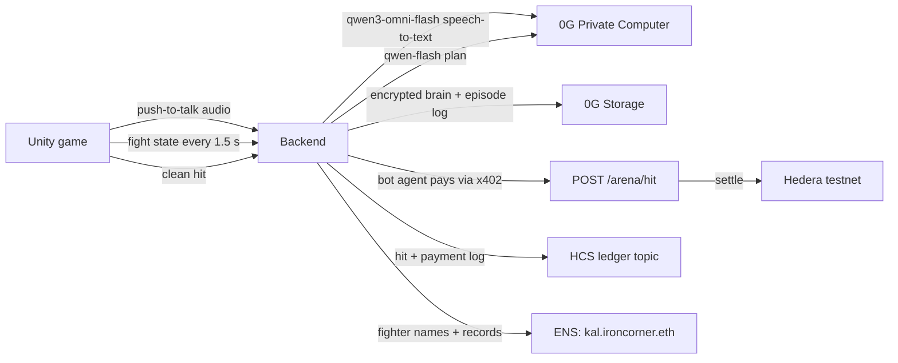

# Iron Corner

You teach a robot boxer by boxing with it and coach it with your voice. In the ring it fights on its own, and its health is its wallet: every clean hit it takes pays the other corner on-chain, and no human approves the payment. When the wallet can't cover the next hit, the bot is knocked out.

Built at ETHGlobal Mumbai 2026. Everything runs on testnets with test tokens.

- Live backend: https://iron-corner.fly.dev (`/health` lists which integrations are live)
- Game: Unity 6 (iOS, Android, macOS), in `unity/`
- API contract between the game and the backend: [`docs/spec.md`](docs/spec.md)

## How a fight works



1. Spar. You box the sparring dummy yourself on the move pad. Each move is saved as a demo, together with the situation (range, guards, what the dummy just threw) and the result: landed, blocked, slipped, missed or got you hit. A round lasts 30 seconds. In a fight, the bot looks up the 6 demos closest to the current moment and 0G picks a plan with those demos in the prompt, so the bot fights the way you showed it. Its bubble then reads something like "Like your coach: slip right then uppercut (worked 6/6)". The bot's own fights add demos too, at a lower weight.
2. Coach. Hold the mic and say something like "when he throws a left hook, slip right and uppercut". `qwen3-omni-flash` on 0G transcribes it and `qwen-flash` turns it into one brain rule: a counter, an opener or finisher combo, a style nudge, or a catchphrase. The game shows what the bot learned ("Learned counter: hook_l → dodge_r, uppercut") next to the 0G request id. The dummy then throws that left hook so you can watch the counter land. Three drills a day keep a streak going.
3. Remember. Saving the brain encrypts it with a per-bot AES-256 key and stores it on 0G Storage. Every save is a new version with its own root hash.
4. Scout. Before meeting an opponent it has no notes on, the bot can decide by itself to buy a scouting report built from that opponent's past fights (their tapes on 0G Storage). The report costs 2 cents, paid over x402 from the bot's own Hedera account, and the notes go into its brain.
5. Fight. You can't coach during a fight. Every 1.5 s each bot sends the fight state to the backend, and 0G picks a stance and a combo from that bot's brain and names the rule it used. The bubble shows, for example, "Using: counter: hook_l → dodge_r, uppercut (learned in training)". The server resolves every exchange, so nobody can cheat from their phone, and Unity plays the result. Each clean hit makes the defender's agent pay the attacker through an x402-protected endpoint that settles on Hedera.
6. Learn. After the fight, 0G writes 1 to 3 lessons per bot into its brain. The full fight log, with every decision and its 0G request id and every hit and payment, goes to 0G Storage as an episode, and the game can replay the fight from it.

If 0G fails or takes longer than 4 s, the bot covers up and holds still until a real plan arrives. It never makes up a move.

Without 0G the bot can't hear you, can't decide, and forgets everything it learned. Your demos still get recorded, but nothing turns them into moves.

## Growth and fairness

Your bot improves the more you train it. The home screen shows a level and five stats (reflexes, accuracy, defense, ring IQ and experience), all computed from the demo library and fight history, so practice is the only way to raise them. You get 5 sparring rounds of energy a day, refilled at 00:00 UTC. Training past that still teaches the bot but earns no XP. XP also drops with each extra round or fight on the same day, and moves you stop practising lose weight after two days.

Every bot has the same body. Damage, speed and reach are identical, and no stat or level changes them; only the brain differs. Each brain save on 0G Storage includes the demo library and a snapshot of the level and stats, so every version records how good the bot was at that point.

## A new player's first session

1. Create a fighter: pick a name and one of six paint schemes. The server gives it its own Hedera testnet account and mints it a 0G Agentic ID (an ERC-7857-style token on Galileo).
2. The fighter is registered as `<name>.ironcorner.eth` on ENSv2 (Sepolia), owned by the fighter's own key.
3. Train one round. The queue turns away untrained fighters, so spar a 30-second round and teach at least one line.
4. Add test funds: testnet HBAR from the house faucet, once a day.
5. Find a fight. Pick a stake and join the queue. Every 2 seconds the matcher pairs fighters with the same stake inside a rating window that widens the longer they wait, and never pairs two fighters from the same owner. It picks at random (`crypto.randomInt`) among the 3 closest ratings. After 25 seconds with no human opponent you get a house sparring bot at your level.
6. Watch the fight. The server runs it and both bots decide on 0G every 1.5 seconds. All random rolls come from a seed whose SHA-256 is published when the fight starts and whose value is revealed when it ends, so anyone can replay the fight from its 0G episode log and check it. Ratings use Elo.

## Fight camp: a fine-tuned model per fighter

"Send to camp" turns a fighter's sparring demos into a training set, with the moves that worked weighted up, and runs a real LoRA fine-tune of Qwen2.5-0.5B on 0G Compute. Each camp produces a new adapter version, recorded on the fighter's Agentic ID. On 24 fight situations it had never seen, the base model matched the coach 0/24 times and our third camp matched 17/24, including 10/10 on hook counters. Task ids, fees and what changed between camps are in [`camp/RESULTS.md`](camp/RESULTS.md).

In fights, the server loads the fighter's newest adapter on top of the base model (as 0G's fine-tuning docs describe) and puts its suggested moves in the prompt. `qwen-flash` on 0G makes the final call, and the bubble says when a move came from the fighter's own model.

## Sponsor integrations

The per-sponsor maps link to the exact lines of code: [0G](docs/integrations/0g.md), [Hedera](docs/integrations/hedera.md), [ENS](docs/integrations/ens.md).

### 0G: Private Computer and Storage

- Inference goes through the 0G router (`https://router-api.0g.ai/v1`, OpenAI-compatible). `qwen3-omni-flash` transcribes coaching audio. `qwen-flash` turns coaching into rules, picks fight plans (about 1.2 s median in our measurements) and writes the lessons after each fight. The game shows each response's `x_0g_trace.request_id` next to the bot's plan.
- Brains hold the rules, the demo library and a level/stats snapshot. They are AES-256 encrypted on 0G Storage (Galileo testnet) with a per-bot key derived through HKDF from a server secret, so only that bot's server side can read them.
- Each fight is uploaded once as a public episode log with a request id per decision. `GET /fights/:id/episode` reads it back from 0G Storage, and the game's "Replay from 0G" button plays it.

### Hedera: x402 agent payments, no Solidity

- `POST /arena/hit` is x402-protected (`exact` scheme, `hedera:testnet`, facilitator `https://x402.org/facilitator`). The price and `payTo` are set per hit: the damage in cents, paid to the attacking bot.
- Each bot has its own Hedera account and its own x402 client, and the defender's agent pays without any human approval. Payments run in a background queue so the fight never waits on settlement, which takes 2 to 6 s.
- Spending controls: each bot enters a fight with a budget equal to its health. The client caps each payment, and the bot is knocked out rather than paying past its budget.
- Scouting: `POST /arena/scout` is a second x402 route. A bot buys a report on its next opponent only when it has no notes on them and there are tapes to study. Nobody tells it to spend.
- Audit log: every fight start, hit, payment, KO and episode root is written to an HCS topic.
- Tokens (HTS): one `IRON` NFT collection. Every fighter gets a card NFT in its own account, with HIP-412 metadata at `/nft/<botId>` pointing to its 0G brain. Serial 1 is the Mumbai Belt, which moves on Hedera from its holder to whoever beats them in a ranked fight.

Payments settle in testnet HBAR (1 cent of damage = 0.01 HBAR). Setting `PAY_ASSET=usdc` switches to testnet USDC (`0.0.429274`) once the operator holds some.

### ENS: every fighter is a name (ENSv2 on Sepolia)

- `ironcorner.eth` is registered on ENSv2 with its own UserRegistry. Each fighter gets a subname such as [`kal.ironcorner.eth`](https://sepolia.app.ens.domains/kal.ironcorner.eth), owned by the fighter's own key, the same key as its Hedera account. The subname is registered with no roles, so the fighter can't point it at another resolver.
- Each name has its own PermissionedResolver, and Enhanced Access Control decides who may write which keys. The arena's wallet can write only the fight keys: `ironcorner.record`, `rating`, `brain` (0G root), `agentid`, `hedera` and `nft`. The fighter's key can write only `description` and `avatar`. We tested all four allow/deny cases against the live resolver.
- The arena updates the record after every fight. The owner edits the bio from the game (`PUT /bots/:id/ens`), and the fighter's own key signs that transaction.
- Any ENS client can read a fighter through the Universal Resolver, for example `getEnsText({ name: "kal.ironcorner.eth", key: "ironcorner.record" })`.

Notes from building it: [`docs/ens-feedback.md`](docs/ens-feedback.md).

## Deployed contracts and proofs

### What we deployed

| Network | What | Address / id |
|---|---|---|
| 0G Galileo (chain 16602) | `IronCornerAgent`, the Agentic ID contract ([source](contracts/IronCornerAgent.sol)) | [`0x4Ed79445a389C9442657773138e2ffFabb25d170`](https://chainscan-galileo.0g.ai/address/0x4Ed79445a389C9442657773138e2ffFabb25d170), deploy tx [`0x7a7e8ac0…4bee`](https://chainscan-galileo.0g.ai/tx/0x7a7e8ac06dcf559fd3f93749eb1cce83c073c732db91fb573732d068bc974bee) |
| Hedera testnet | Fight ledger (HCS topic) | [`0.0.11326019`](https://hashscan.io/testnet/topic/0.0.11326019) |
| Hedera testnet | `IRON` NFT collection (HTS) | [`0.0.11341901`](https://hashscan.io/testnet/token/0.0.11341901) |
| Hedera testnet | Operator account | [`0.0.9185802`](https://hashscan.io/testnet/account/0.0.9185802) |
| Sepolia (ENSv2) | `ironcorner.eth` registration | tx [`0x0eefe045…5e47`](https://sepolia.etherscan.io/tx/0x0eefe045dd84964a7a8588e2a2460b995d2b46ddbedb70701f1b5357ba2e5e47) |
| Sepolia (ENSv2) | `ironcorner.eth` UserRegistry | [`0xAaba88effc53B7eADd51C4D11eB5821b6a7a95EE`](https://sepolia.etherscan.io/address/0xAaba88effc53B7eADd51C4D11eB5821b6a7a95EE) |

ENSv2 contracts we call on Sepolia, deployed by ENS and listed in [`backend/src/ens.ts`](backend/src/ens.ts): Universal Resolver `0xeEeEEEeE14D718C2B47D9923Deab1335E144EeEe`, resolver factory `0xda70306c98e97ece36f997a21368e53298572991`, PermissionedResolver implementation `0x115eb53f0c60696633855f90b138178fb40b2b2c`, UserRegistry implementation `0x9bd8a88719068d09ecee662f36c0e3856708366a`, registrar `0xf633e7fc17e2bbe0d0965d18ec1821dcb754a3d3`.

### The fight in the demo video

Fight `f_1a7809d7c6` (7 Nov 2026, 02:34 IST): Cobalt King beat Red Fang by KO, and all 14 x402 payments settled.

| | Cobalt King (winner) | Red Fang |
|---|---|---|
| Bot id | `bot_269dfac1bd` | `bot_b707576877` |
| Hedera account | [`0.0.11345556`](https://hashscan.io/testnet/account/0.0.11345556) | [`0.0.11345557`](https://hashscan.io/testnet/account/0.0.11345557) |
| ENS name | [`cobalt-king.ironcorner.eth`](https://sepolia.app.ens.domains/cobalt-king.ironcorner.eth) | [`red-fang.ironcorner.eth`](https://sepolia.app.ens.domains/red-fang.ironcorner.eth) |
| IRON NFT | [serial 13](https://hashscan.io/testnet/token/0.0.11341901/13) | [serial 14](https://hashscan.io/testnet/token/0.0.11341901/14) |
| 0G Agentic ID | #12, mint tx [`0xa52f51c0…cdffa`](https://chainscan-galileo.0g.ai/tx/0xa52f51c06776f7b6e0b7fbae1975b65366cb154f104b8f582878ce9f732cdffa) | |

| Proof | Id |
|---|---|
| Brain v1 on 0G Storage | root `0x4deef0cb8e79b17bafca7c3e0d8520340a85de637f1df6b3722ddf28fca0da6f`, tx [`0xcce26922…3446`](https://chainscan-galileo.0g.ai/tx/0xcce2692257d253669f544d7bbe73b59533f8588e1843ba342c98ca2be4c23446) |
| Episode log on 0G Storage | root `0x4552a016e14069e9c19038228908e7de2954e2f5b7b828d140b1f99eae416aba`, tx [`0x02e2da95…2c07b`](https://chainscan-galileo.0g.ai/tx/0x02e2da95184da049715b6fda32e5d5df56e47fe0fdabbf0c7d2e4fb1c142c07b) |
| Fairness seed | hash `81adc862801b4015154b2f5d128c12adcd44bf40d956f2fa88641b9ca8f67469` published at the start, seed `a3d63e6d6a7d6a2785ba7952d2bd7cab973b264d8528df2c14c289e62fd11d92` revealed at the end |
| Example x402 hit payment | [`0.0.9185802@1793999044.780857311`](https://hashscan.io/testnet/transaction/0.0.9185802-1793999044-780857311) |
| HCS ledger messages | sequence 875 to 916 on [`0.0.11326019`](https://hashscan.io/testnet/topic/0.0.11326019) (KO at 911, episode root at 916) |

### Other proofs

| What | Id |
|---|---|
| 0G speech-to-text request | `fe84c632-36ef-4080-a48c-5ff52b3a7ac5` |
| 0G fight decision request | `3f4bfb86-36d5-4385-ae33-dc877910fb7a` |
| x402 scouting purchase | [`0.0.9185802@1793980146.210053593`](https://hashscan.io/testnet/transaction/0.0.9185802-1793980146-210053593) |
| Mumbai Belt transfer | fight `f_0e19246895`, HCS message 782 |
| `kal.ironcorner.eth` registration | tx [`0x02f3eeab…186d`](https://sepolia.etherscan.io/tx/0x02f3eeab20a67af7c83e5908c34b557861762b44a81c02d351a07963dfdd186d), resolver `0x78c53530206B3E94176AAdbe09FC700551ccafeB` |
| Bio signed by the fighter's own key | tx [`0xb0954e0a…ac22`](https://sepolia.etherscan.io/tx/0xb0954e0a923bcc851ec760478d098dfee345bee69c1400a9830192eca43dac22) |
| Fight camp fine-tunes on 0G Compute | task ids, fees and acknowledgement txs in [`camp/RESULTS.md`](camp/RESULTS.md) |

## Run it

Backend (Node 22+):

```sh
cd backend
npm install
npm start            # port 8787; each integration runs live if its keys are set, mock otherwise
npm run smoke        # full loop: coach, spar, save brain, fight, payments, approvals
```

Keys go in `backend/.env` (see `.env.example`). With no keys at all, everything runs in mock mode and says so.

Game: open `unity/` in Unity 6000.3.26f1, or build from the command line:

```sh
Unity -batchmode -quit -projectPath unity -executeMethod Setup.Build      # builds scenes and robot prefabs
Unity -batchmode -quit -projectPath unity -executeMethod Setup.BuildMac   # macOS player
```

The game talks to `https://iron-corner.fly.dev` by default (you can change it on the home screen). If it can't reach a server it falls back to an offline mode, labelled as such.

## Credits

- Robot models (CC BY 4.0): "Dark Giant Robot Golem Steel Armor Pipes" by Pigcraft on Sketchfab.
- Boxing animations: Mixamo. Mixamo files can't be redistributed, so they aren't in this repo; see `unity/README.md`.
