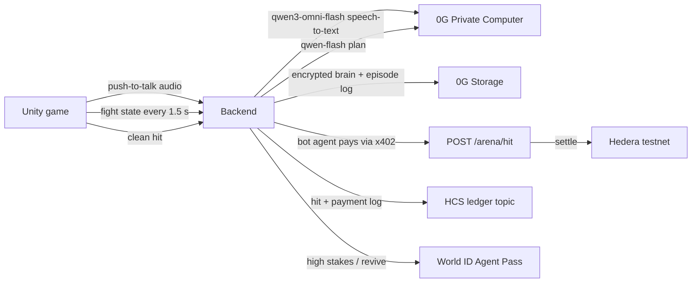

# Iron Corner

Train a robot boxer with your voice. In the ring it fights on its own, and its health is its wallet: every clean hit it takes pays the other corner, on-chain, with no human approving the payment. When the wallet can't cover the next hit, the bot is knocked out.

Built at ETHGlobal Mumbai 2026. Everything runs on testnets with test tokens.

- Live backend: https://iron-corner.fly.dev (`/health` shows which integrations are live)
- Game: Unity 6 (iOS, Android, macOS), in `unity/`
- Contract between the two: [`docs/spec.md`](docs/spec.md)

## How a fight works



1. Train: you hold the mic and coach ("when he throws a left hook, slip right and uppercut"). 0G's `qwen3-omni-flash` transcribes it, and `qwen-flash` on 0G turns it into one brain rule: a counter, an opener or finisher combo, a style nudge, or a catchphrase. The game shows what it learned ("Learned counter: hook_l → dodge_r, uppercut") with the 0G request id. The sparring dummy then throws that left hook so you can watch the counter land. Three drills a day keeps a streak going.
2. Remember: saving the brain encrypts it with a per-bot AES-256 key and stores it on 0G Storage. Each save is a new version with its own root hash.
3. Approve: entering a high-stakes fight or reviving a knocked-out bot needs a fresh World ID approval from the owner. A denied, expired or cancelled request means the action does not happen.
4. Fight: you can't coach during a fight. Every 1.5 s each bot sends the fight state to the backend, and 0G picks a stance and a combo from that bot's brain, naming the rule it followed. The bubble shows "Using: counter: hook_l → dodge_r, uppercut (learned in training)". Unity plays the moves and detects hits. Each clean hit makes the defender's agent pay the attacker through an x402-protected endpoint that settles on Hedera.
5. Learn: after the fight, 0G writes 1 to 3 lessons per bot into its brain. The whole fight (every decision with its 0G request id, every hit and payment) is uploaded to 0G Storage as an episode log, and the game can replay the fight from that log.

If 0G fails or is slow (over 4 s), the bot covers up and holds still until a real plan arrives. It never makes up a move.

Without 0G the bot can't hear you, can't decide, and forgets everything it learned.

## Sponsor integrations

### 0G: Private Computer and Storage

- Inference through the 0G router (`https://router-api.0g.ai/v1`, OpenAI-compatible): `qwen3-omni-flash` for coaching audio (speech-to-text), `qwen-flash` for turning coaching into rules and for fight plans (about 1.2 s median measured), lessons after each fight. Every response's `x_0g_trace.request_id` is shown in the game next to the bot's plan.
- Brains: AES-256 encrypted on 0G Storage (Galileo testnet), keyed per bot with HKDF from a server secret, so only that bot's server side can read them.
- Episode logs: one public upload per fight with a request id per decision. `GET /fights/:id/episode` reads it back from 0G Storage, and the game's "Replay from 0G" button replays it.

Example ids from our test runs:

| What | Id |
|---|---|
| Speech-to-text request | `fe84c632-36ef-4080-a48c-5ff52b3a7ac5` |
| Fight decision request | `3f4bfb86-36d5-4385-ae33-dc877910fb7a` |
| Brain v9 root | `0xef2357df712b8616e4dc9a2d9f20061a8c20b1fbf5a71daa5536c8a3aed5ac92` |
| Brain v9 upload tx | `0x941d3a62c31c09edc400a8fb66a3a1bed14ed7b73374cf401328f335cf0fb192` |

### Hedera: x402 agent payments

- `POST /arena/hit` is x402-protected (`exact` scheme, `hedera:testnet`, facilitator `https://x402.org/facilitator`). Price and `payTo` are set per hit: damage in cents, paid to the attacking bot.
- Each bot has its own Hedera account and its own x402 client. The defender's agent pays on its own; no human approves anything. Payments run in a background queue so the fight never waits (settlement takes 2 to 6 s).
- Spending controls: each bot enters a fight with a budget (its health). The client caps each payment, and the bot is knocked out instead of paying past its budget. High-stakes fights need a human approval through World ID first.
- Audit log: every fight start, hit, payment, KO and episode root goes to HCS topic [`0.0.11326019`](https://hashscan.io/testnet/topic/0.0.11326019).

| What | Id |
|---|---|
| Bot accounts | [`0.0.11326017`](https://hashscan.io/testnet/account/0.0.11326017) (Brass Knuckle), [`0.0.11326018`](https://hashscan.io/testnet/account/0.0.11326018) (Rustbucket) |
| Settled x402 payment | [`0.0.9185802@1793892026.824260886`](https://hashscan.io/testnet/transaction/0.0.9185802-1793892026-824260886) |
| Fight ledger (HCS) | [`0.0.11326019`](https://hashscan.io/testnet/topic/0.0.11326019) |

Payments currently settle in testnet HBAR (1 cent of damage = 0.01 HBAR). Setting `PAY_ASSET=usdc` switches to testnet USDC (`0.0.429274`) once the operator holds some.

### World: ID Agent Pass

- The backend starts an OpenID Connect device-flow request on `auth.world.org` when an action needs a human: entering a high-stakes fight, or reviving a knocked-out bot.
- The game shows the QR code and user code. The owner approves in World App while the backend polls.
- The backend validates the ID token itself (issuer, subject pinned to the bot's owner, `acr`, `amr` containing `pop`, fresh `auth_time`), then marks the approval used in the same step that runs the action. An approval works once.
- Denied, expired and cancelled requests all leave the action undone. The game says "Not approved, nothing happened."
- Integration debrief: [`docs/world-debrief.md`](docs/world-debrief.md).

## Run it

Backend (Node 22+):

```sh
cd backend
npm install
npm start            # port 8787; each integration runs live if its keys are set, mock otherwise
npm run smoke        # full loop: coach, spar, save brain, fight, payments, approvals
```

Keys go in `backend/.env` (see `.env.example`). Without any keys everything runs in mock mode, clearly marked.

Game: open `unity/` in Unity 6000.3.26f1, or build from the command line:

```sh
Unity -batchmode -quit -projectPath unity -executeMethod Setup.Build      # builds scenes and robot prefabs
Unity -batchmode -quit -projectPath unity -executeMethod Setup.BuildMac   # macOS player
```

The game talks to `https://iron-corner.fly.dev` by default (changeable on the home screen) and falls back to a clearly labelled offline mode if it can't reach a server.

## Credits

- Robot models (CC BY 4.0): "Dark Giant Robot Golem Steel Armor Pipes" by Pigcraft on Sketchfab.
- Boxing animations: Mixamo. Mixamo files can't be redistributed, so they are not in this repo; see `unity/README.md`.
