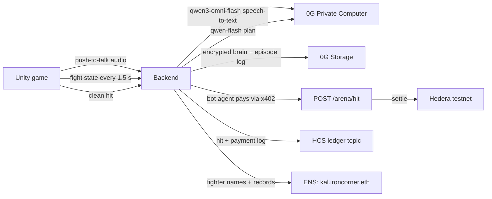

# Iron Corner

Teach a robot boxer by boxing with it, and coach it with your voice. In the ring it fights on its own, and its health is its wallet: every clean hit it takes pays the other corner, on-chain, with no human approving the payment. When the wallet can't cover the next hit, the bot is knocked out.

Built at ETHGlobal Mumbai 2026. Everything runs on testnets with test tokens.

- Live backend: https://iron-corner.fly.dev (`/health` shows which integrations are live)
- Game: Unity 6 (iOS, Android, macOS), in `unity/`
- Contract between the two: [`docs/spec.md`](docs/spec.md)

## How a fight works



1. Spar: on the move pad you box the sparring dummy yourself. Every move is saved as a demo with the moment it happened in (range, guards, what the dummy just threw) and how it went: landed, blocked, slipped, missed or got you hit. A round is 30 seconds. In fights the bot looks up the 6 demos closest to the moment and 0G picks its plan with them in the prompt, so it fights the way you showed it. The bubble then says "Like your coach: slip right then uppercut (worked 6/6)". Its own fights add low-weight demos too.
2. Coach: you hold the mic and coach ("when he throws a left hook, slip right and uppercut"). 0G's `qwen3-omni-flash` transcribes it, and `qwen-flash` on 0G turns it into one brain rule: a counter, an opener or finisher combo, a style nudge, or a catchphrase. The game shows what it learned ("Learned counter: hook_l → dodge_r, uppercut") with the 0G request id. The sparring dummy then throws that left hook so you can watch the counter land. Three drills a day keeps a streak going.
3. Remember: saving the brain encrypts it with a per-bot AES-256 key and stores it on 0G Storage. Each save is a new version with its own root hash.
4. Scout: before meeting an opponent it knows nothing about, the bot decides by itself to buy a scouting report on that opponent's past fights (its 0G Storage tapes) for 2 cents, paid over x402 from its own Hedera account. The notes go into its brain.
5. Fight: you can't coach during a fight. Every 1.5 s each bot sends the fight state to the backend, and 0G picks a stance and a combo from that bot's brain, naming the rule it followed. The bubble shows "Using: counter: hook_l → dodge_r, uppercut (learned in training)". The server resolves every exchange (so nobody can cheat from their phone) and Unity plays the result. Each clean hit makes the defender's agent pay the attacker through an x402-protected endpoint that settles on Hedera.
6. Learn: after the fight, 0G writes 1 to 3 lessons per bot into its brain. The whole fight (every decision with its 0G request id, every hit and payment) is uploaded to 0G Storage as an episode log, and the game can replay the fight from that log.

If 0G fails or is slow (over 4 s), the bot covers up and holds still until a real plan arrives. It never makes up a move.

Without 0G the bot can't hear you, can't decide, and forgets everything it learned. Your demos still get recorded, but nothing turns them into moves.

## Growth and fairness

Your bot gets better the more you train it, and it shows on the home screen as a level and five stats: reflexes, accuracy, defense, ring IQ and experience. All five are worked out from the demo library and fight history, so the only way to raise them is to practise. You get 5 sparring rounds of energy a day, refilled at 00:00 UTC. After that, training still teaches the bot but earns no XP. XP also shrinks with each round or fight on the same day, and moves you stop practising lose weight after two days. Every bot has the same body: damage, speed and reach are identical, and no stat or level changes them. Only the brain differs. Each brain save on 0G Storage includes the demo library and a snapshot of the level and stats, so every version is a record of how good the bot was at that point.

## A new player's first session

1. **Create** a fighter: a name and one of six paint schemes. The server gives it its own Hedera testnet account and mints it a 0G Agentic ID (ERC-7857-style token on Galileo, contract `0x4Ed79445a389C9442657773138e2ffFabb25d170`).
2. **Get a name.** The fighter is registered as `<name>.ironcorner.eth` on ENSv2 (Sepolia), owned by the fighter's own key.
3. **Train one round first.** The queue refuses untrained fighters. Spar a 30-second round on the move pad and teach at least one line.
4. **Add test funds** (testnet HBAR from the house faucet, capped once a day).
5. **Find a fight**: pick a stake and join the queue. Every 2 seconds the matcher pairs fighters with the same stake, never two fighters of the same owner, inside a rating window that widens the longer you wait. It picks at random (`crypto.randomInt`) among the 3 closest ratings, so the pairing is fair but not predictable. After 25 seconds with no human opponent you get a house sparring bot of your level.
6. **Watch the fight.** The server runs it: both bots decide on 0G every 1.5 seconds, every random roll comes from a seed whose SHA-256 is published when the fight starts and whose value is revealed when it ends, so anyone can replay the fight from its 0G episode log and check it. Ratings use Elo.

A live matched fight between two newly created fighters, `f_1e4257a3d1`: seed hash `c7cae7b6…455c` published at the start, seed `06412dde…ddcd` revealed at the end, 5 settled x402 payments (e.g. `0.0.9185802@1793914960.945634213`), episode root on 0G Storage `0x998af99e…73fe`, ratings 984 / 1016.

## Fight camp: each fighter gets its own fine-tuned model

"Send to camp" turns a fighter's sparring demos into a training set (the moves that worked, weighted up) and runs a real LoRA fine-tune of Qwen2.5-0.5B on 0G Compute. Each camp is a new adapter version, recorded on the fighter's Agentic ID. On 24 fight situations it never saw, the base model matched the coach 0/24 times; our third camp matched 17/24, including 10/10 on hook counters. Task ids, fees and what made the difference are in [`camp/RESULTS.md`](camp/RESULTS.md). In fights, the server loads the fighter's newest adapter on top of the base model (the way 0G's fine-tuning docs describe) and puts its suggested moves in the prompt. `qwen-flash` on 0G makes the final call, and the bubble says when a move came from the fighter's own model.

## Sponsor integrations

Every place each sponsor's tech is used, with links to the exact lines: [0G](docs/integrations/0g.md), [Hedera](docs/integrations/hedera.md), [ENS](docs/integrations/ens.md).

### 0G: Private Computer and Storage

- Inference through the 0G router (`https://router-api.0g.ai/v1`, OpenAI-compatible): `qwen3-omni-flash` for coaching audio (speech-to-text), `qwen-flash` for turning coaching into rules and for fight plans (about 1.2 s median measured), lessons after each fight. Every response's `x_0g_trace.request_id` is shown in the game next to the bot's plan.
- Brains: rules, the demo library and a level/stats snapshot, AES-256 encrypted on 0G Storage (Galileo testnet), keyed per bot with HKDF from a server secret, so only that bot's server side can read them.
- Episode logs: one public upload per fight with a request id per decision. `GET /fights/:id/episode` reads it back from 0G Storage, and the game's "Replay from 0G" button replays it.

Example ids from our test runs:

| What | Id |
|---|---|
| Speech-to-text request | `fe84c632-36ef-4080-a48c-5ff52b3a7ac5` |
| Fight decision request | `3f4bfb86-36d5-4385-ae33-dc877910fb7a` |
| Brain v9 root | `0xef2357df712b8616e4dc9a2d9f20061a8c20b1fbf5a71daa5536c8a3aed5ac92` |
| Brain v9 upload tx | `0x941d3a62c31c09edc400a8fb66a3a1bed14ed7b73374cf401328f335cf0fb192` |

### Hedera: x402 agent payments

- `POST /arena/hit` is x402-protected (`exact` scheme, `hedera:testnet`, facilitator `https://x402.org/facilitator`). Price and `payTo` are set per hit: damage in cents, paid to the attacking bot.
- Each bot has its own Hedera account and its own x402 client. The defender's agent pays on its own; no human approves anything. Payments run in a background queue so the fight never waits (settlement takes 2 to 6 s).
- Spending controls: each bot enters a fight with a budget (its health). The client caps each payment, and the bot is knocked out instead of paying past its budget.
- Audit log: every fight start, hit, payment, KO and episode root goes to HCS topic [`0.0.11326019`](https://hashscan.io/testnet/topic/0.0.11326019).

| What | Id |
|---|---|
| Bot accounts | [`0.0.11326017`](https://hashscan.io/testnet/account/0.0.11326017) (Brass Knuckle), [`0.0.11326018`](https://hashscan.io/testnet/account/0.0.11326018) (Rustbucket) |
| Settled x402 payment | [`0.0.9185802@1793892026.824260886`](https://hashscan.io/testnet/transaction/0.0.9185802-1793892026-824260886) |
| Fight ledger (HCS) | [`0.0.11326019`](https://hashscan.io/testnet/topic/0.0.11326019) |

- Scouting: `POST /arena/scout` is a second x402 route. A bot buys a report on its next opponent only when it has no notes on them and there are tapes to study, so nobody tells it to spend. Example purchase: [`0.0.9185802@1793980146.210053593`](https://hashscan.io/testnet/transaction/0.0.9185802-1793980146-210053593).
- Tokens (HTS, no Solidity): one `IRON` NFT collection. Every fighter gets a card NFT in its own account, with HIP-412 metadata at `/nft/<botId>` pointing to its 0G brain. Serial 1 is the Mumbai Belt, which moves on Hedera from its holder to whoever beats them in a ranked fight.

Payments currently settle in testnet HBAR (1 cent of damage = 0.01 HBAR). Setting `PAY_ASSET=usdc` switches to testnet USDC (`0.0.429274`) once the operator holds some.

### ENS: every fighter is a name (ENSv2 on Sepolia)

- `ironcorner.eth` is registered on ENSv2 with its own UserRegistry. Each fighter gets a subname such as [`kal.ironcorner.eth`](https://sepolia.app.ens.domains/kal.ironcorner.eth), owned by the fighter's own key (the same key as its Hedera account). The subname is registered with no roles, so the fighter can't point it at another resolver.
- Each name has its own PermissionedResolver, and Enhanced Access Control splits who may write which keys. The arena's wallet may write only the fight keys: `ironcorner.record`, `rating`, `brain` (0G root), `agentid`, `hedera` and `nft`. The fighter's key may write only `description` and `avatar`. Neither side can write the other's keys. We checked all four cases against the live resolver.
- The arena updates the record after every fight. The owner edits the bio from the game (`PUT /bots/:id/ens`), and the fighter's own key signs that transaction.
- Any ENS client resolves it through the Universal Resolver: `getEnsText({ name: "kal.ironcorner.eth", key: "ironcorner.record" })`.

| What | Id |
|---|---|
| ironcorner.eth registration | [`0x0eefe045…5e47`](https://sepolia.etherscan.io/tx/0x0eefe045dd84964a7a8588e2a2460b995d2b46ddbedb70701f1b5357ba2e5e47) |
| UserRegistry | `0xAaba88effc53B7eADd51C4D11eB5821b6a7a95EE` |
| kal.ironcorner.eth | [`0x02f3eeab…186d`](https://sepolia.etherscan.io/tx/0x02f3eeab20a67af7c83e5908c34b557861762b44a81c02d351a07963dfdd186d), resolver `0x78c53530206B3E94176AAdbe09FC700551ccafeB` |
| Bio signed by the fighter's own key | [`0xb0954e0a…ac22`](https://sepolia.etherscan.io/tx/0xb0954e0a923bcc851ec760478d098dfee345bee69c1400a9830192eca43dac22) |

Notes from building it: [`docs/ens-feedback.md`](docs/ens-feedback.md).

## Run it

Backend (Node 22+):

```sh
cd backend
npm install
npm start            # port 8787; each integration runs live if its keys are set, mock otherwise
npm run smoke        # full loop: coach, spar, save brain, fight, payments, approvals
```

Keys go in `backend/.env` (see `.env.example`). Without any keys everything runs in mock mode, clearly marked.

Game: open `unity/` in Unity 6000.3.26f1, or build from the command line:

```sh
Unity -batchmode -quit -projectPath unity -executeMethod Setup.Build      # builds scenes and robot prefabs
Unity -batchmode -quit -projectPath unity -executeMethod Setup.BuildMac   # macOS player
```

The game talks to `https://iron-corner.fly.dev` by default (changeable on the home screen) and falls back to a clearly labelled offline mode if it can't reach a server.

## Credits

- Robot models (CC BY 4.0): "Dark Giant Robot Golem Steel Armor Pipes" by Pigcraft on Sketchfab.
- Boxing animations: Mixamo. Mixamo files can't be redistributed, so they are not in this repo; see `unity/README.md`.
